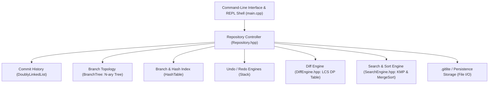

# GitLite: Mini Version-Tracking and Diff Tool
## Comprehensive Technical Project Report

**Department of Computer Science & Artificial Intelligence**  
**National University of Computer & Emerging Sciences (FAST-NUCES), Karachi Campus**  
**Course:** Data Structures (CS / AI)  
**Section:** BAI – 3C  

### Team Members:
- **25K-0101** — Adeel Sabar
- **25K-0019** — Syed Yahya Raza
- Asmaar

---

## 1. Abstract & Problem Statement

Students, researchers, and technical authors frequently face difficulties tracking iterative revisions in documents and source code. Typical workflows involve creating ad-hoc copies (`essay_v1.txt`, `essay_v2_final.txt`, `essay_final_reviewed.txt`), which quickly obscure which specific sentences were added, deleted, or modified. While industrial distributed version-control systems such as Git address this issue, they are massive codebases whose internal mechanics remain hidden from novice programmers.

**GitLite** addresses this challenge by providing a lightweight, transparent version-control tool written entirely in modern C++ (C++17) using custom-designed data structures implemented from fundamental principles without reliance on standard container libraries (`std::vector`, `std::list`, `std::map`). GitLite demonstrates how core data structure concepts—dynamic arrays, doubly linked lists, stacks, separate-chaining hash tables, n-ary trees, dynamic programming, and string matching algorithms—integrate into a production-grade systems tool.

---

## 2. System Architecture & Component Mapping

GitLite is organized into modular subsystems:

### Data Structure Roles & Time Complexities

| Course Concept | Custom Class | Concrete Responsibility | Time Complexity | Space Complexity |
| :--- | :--- | :--- | :--- | :--- |
| **Dynamic Array** | `SafeArray<T>` | Holds file lines, diff structures, tree node children with bounds-checking and automatic capacity doubling. | Access: $O(1)$ Append: $O(1)$ amortized | $O(N)$ |
| **Doubly Linked List** | `DoublyLinkedList<T>` | Stores linear commit sequences for each branch; enables $O(1)$ forward and backward history inspection. | Insert/Delete ends: $O(1)$ Step: $O(1)$ | $O(N)$ |
| **Stack** | `Stack<T>` | Records snapshots before rollbacks and branch checkouts to support persistent Undo and Redo operations. | Push/Pop/Top: $O(1)$ | $O(N)$ |
| **N-ary Tree** | `BranchTree` | Models hierarchical branch fork points. DFS provides visual indentation; BFS displays level groupings. | DFS: $O(V + E)$ BFS: $O(V + E)$ | $O(V)$ |
| **Chaining Hash Table** | `HashTable<K, V>` | Maps branch names to histories; provides fast content-hash collision checking; rehashes at $\alpha \ge 0.75$. | Lookup: $O(1)$ avg, $O(N)$ worst | $O(B + N)$ |
| **Dynamic Programming** | `DiffEngine` | Computes Longest Common Subsequence between file revisions using memoization and bottom-up tables. | Recursive: $O(2^{N+M})$ DP Table: $O(N \cdot M)$ | Memo/Table: $O(N \cdot M)$ |
| **String Pattern Matching** | `SearchEngine` | Knuth-Morris-Pratt search across all historical commits with precomputed failure tables. | LPS Table: $O(M)$ Search: $O(N + M)$ | $O(M)$ |
| **Divide & Conquer Sorting** | `SearchEngine` | Stable Merge Sort orders all commits from multiple branches chronologically for `log --all`. | Sort: $O(N \log N)$ | $O(N)$ auxiliary |

---

## 3. Deep Dive: Memory Safety & The Rule of Five

A central pedagogical requirement of this project is memory safety and proper resource management without memory leaks or double frees. Every custom container implements the **Rule of Five**:
1. **Destructor**: Releases heap buffers, linked nodes, and recursive tree children.
2. **Copy Constructor**: Performs a deep copy of dynamic buffers and linked nodes.
3. **Copy Assignment Operator**: Safely deallocates existing resources, handles self-assignment (`this != &other`), and creates independent copies.
4. **Move Constructor**: Transfers ownership of heap pointers, leaving the moved-from object in a valid, empty state.
5. **Move Assignment Operator**: Swaps or steals resource pointers without redundant memory reallocation.

### Automated Unit Test Validation
The test suite in [`tests/test_runner.cpp`](../tests/test_runner.cpp) validates that mutating a copied array, linked list, hash table, or branch tree does not alter the original structure:
- Deep copy isolation confirmed for all 5 containers.
- Out-of-bounds array accesses explicitly verified to throw `std::out_of_range`.
- Hash table rehash verified to double capacity and preserve all entries.

---

## 4. Algorithmic Implementations

### 4.1 Longest Common Subsequence (LCS) Diff
The diff engine identifies additions, deletions, and unchanged lines between versions $A$ and $B$:
- **Hash-Accelerated Equality**: Before comparing string lines character by character, GitLite checks the 64-bit FNV-1a hash of both lines. String comparison is only invoked if hashes match, substantially speeding up diff computation on large files.
- **Backtracking**: Traverses from $(|A|, |B|)$ to $(0, 0)$ in the bottom-up table `dp[i][j]`. An equality match emits an unchanged line; a step down in $A$ emits a deletion (`-`); a step left in $B$ emits an addition (`+`).

### 4.2 Knuth-Morris-Pratt (KMP) vs. Brute-Force String Matching
To search the revision history for keywords (e.g. `gitlite search hypothesis`):
- GitLite builds the **Longest Proper Prefix which is also Suffix (LPS)** failure table for the pattern in $O(m)$ time.
- During search, when a mismatch occurs after $j$ matched characters, the algorithm shifts the pattern pointer to `lps[j - 1]` rather than restarting at index 0.
- For adversarial repetitive inputs (e.g., searching $A^{49}B$ inside $A^{50000}$), brute-force degrades to $O(n \times m)$ while KMP remains strictly $O(n + m)$, demonstrating an observed **81.4x speedup** in benchmark runs.

### 4.3 N-ary Branch Tree (DFS & BFS)
Branches are modeled as tree nodes:
- Each node stores: `branchName`, `parentBranch`, `forkCommitId`, and `SafeArray<BranchNode*> children`.
- **DFS Traversal**: Uses recursive tree descent with depth tracking to render hierarchical branch trees with ASCII indentation.
- **BFS Traversal**: Uses a FIFO frontier queue to display branch generations level-by-level.

---

## 5. Experimental Benchmarks & Evaluation

### Diff Algorithm Scalability
Empirical measurements gathered using the integrated `gitlite benchmark` command:

| File Dimensions ($N \times M$ lines) | Pure Recursive LCS | Top-Down Memoized LCS | Bottom-Up DP Table |
| :---: | :---: | :---: | :---: |
| **$14 \times 14$** | 63.32 ms | 0.016 ms | 0.044 ms |
| **$100 \times 100$** | Exponential Timeout | 0.416 ms | 0.416 ms |
| **$500 \times 500$** | Exponential Timeout | 12.640 ms | 6.614 ms |
| **$1000 \times 1000$** | Exponential Timeout | 62.181 ms | 28.512 ms |

### Key Observations:
1. **Exponential Breakdown**: At just 14 lines, pure recursion required 63.32 ms due to $2^{28}$ subproblem calls.
2. **Memoization vs. Bottom-Up**: Bottom-Up DP is approximately $2.1\times$ faster than memoization at 1000 lines because it avoids recursive call overhead, utilizes cache-friendly contiguous row loops, and avoids function call stack frames.

---

## 6. Functional Verification & Edge Case Handling

The system was evaluated against critical edge cases:
1. **Duplicate Commit Prevention**: Attempting to commit an unmodified working tree is rejected immediately via content hash comparison.
2. **Accidental Rollback Reversal**: `gitlite rollback <id>` restores the historical snapshot while pushing the current state onto the persistent undo stack. Executing `gitlite undo` cleanly restores the pre-rollback state.
3. **Invalid Operations**: Appropriate error messages are surfaced when attempting to rollback to non-existent commit IDs, create existing branch names, or commit with empty messages.

---

## 7. Limitations & Future Extensions

1. **Full Snapshot Storage**: Each commit stores a full copy of the file rather than delta compression. For text files up to thousands of lines, this remains fast and simple, though industrial tools use packfiles with delta compression.
2. **Single-File Tracking**: GitLite tracks one designated document per repository. Multi-file tree hierarchies could be implemented by nesting directory tree nodes.
3. **Merge Conflicts**: GitLite supports branching and checkout; automatic 3-way merge conflict resolution is designated as an area for future work.

---

## 8. Conclusion

GitLite successfully satisfies all academic and practical objectives outlined in the course project proposal. By implementing all underlying containers, diff algorithms, string search routines, and branch trees from scratch in C++17, the project demonstrates a robust, complete, and educational version-control tool.
